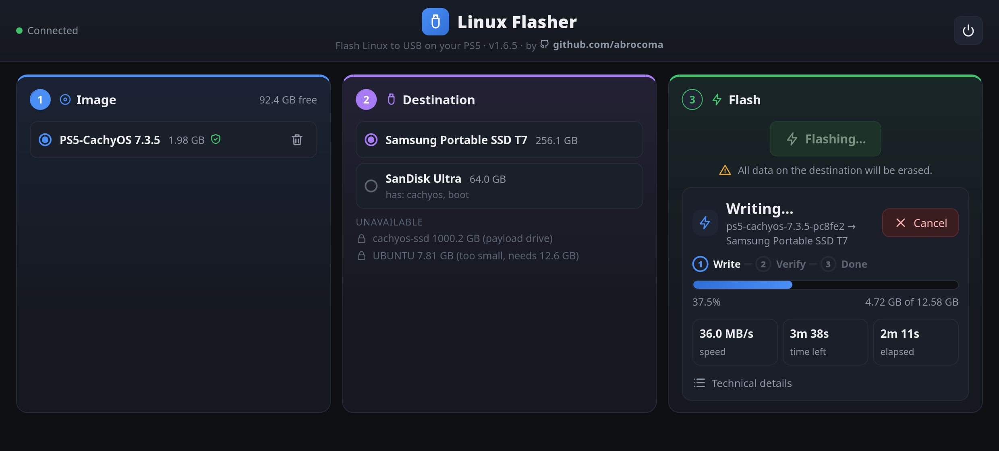

# Linux Flasher for PS5

Flash Linux to a USB drive **from the PS5 itself**. No PC needed.

Linux Flasher is a payload for jailbroken PS5 consoles. It opens a page in the PS5 browser (or on your phone) where you download the image, pick a USB drive and press Flash.

It ships with one image: [PS5-CachyOS](https://github.com/abrocoma/PS5-CachyOS) 7.3.5 (2026-11-25), tested on firmware 13.60 on the PS5 Fat and PS5 Pro.



<sub>Screenshot with example data.</sub>

## Features

- **One tap to download PS5-CachyOS** straight to the PS5, checked against its SHA-256. Works with jailbreak DNS setups; pause and resume.
- **Unpacks while writing**, so no extra space is needed.
- **Checks every byte:** after writing, the drive is read back and compared.
- **Safe by default:** your payload drive is never offered as a target, and drives that are too small are hidden.
- **Home screen tile** under Media, and it keeps running if you close the browser.

## Download

Get `Linux_Flasher.elf` from [Releases](https://github.com/abrocoma/PS5-Linux-Flasher/releases/latest).

Version 1.6.4 and older can no longer download the image (the old image was removed), so use 1.6.5 or newer.

## How to use

1. Copy `Linux_Flasher.elf` to the **root** of the USB drive you load payloads from.
2. Load it like any other payload. The page opens in the PS5 browser (or open the address from the notification on your phone).
3. **Image:** download **PS5-CachyOS 7.3.5** with the download icon (once), then select it.
4. **Destination:** select the USB drive to use. It will be **erased**. At least 16 GB, 64 GB or more recommended.
5. **Flash:** press **Flash image** and wait for **Done**. Then boot the drive with your Linux loader.

> [!WARNING]
> Your payload drive is only protected when `Linux_Flasher.elf` is in its root. If you load the payload another way, check the drive name and size before you press Flash.

- The download stays on the PS5 until you delete it (bin icon), so you can flash more drives without downloading again.
- To quit, use the power button at the top right.

## Feedback

Please open an [issue](https://github.com/abrocoma/PS5-Linux-Flasher/issues) with your PS5 model (Fat disc / Fat digital / Slim / Pro), firmware, the USB drive and what happened. If something failed, attach `Linux_Flasher_report.txt` (saved next to the `.elf`) and a photo of the page.

## Building

The source is in [`src/`](src). Needs the [PS5 payload SDK](https://github.com/ps5-payload-dev/sdk) in `/opt/ps5-payload-sdk` (or set `SDK=`).

```
make -C src
```

## License

GPL-3.0-or-later. See [LICENSE](LICENSE) and [docs/THIRD_PARTY.txt](docs/THIRD_PARTY.txt).
